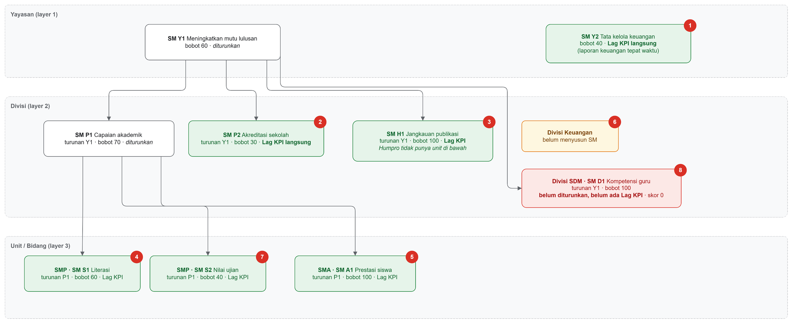

## Kasus-kasus Penurunan dalam Satu Tahun Ajaran

Diagram di bawah ini menjelaskan aturan main penurunan target kerja atau aturan sasaran mutu (SM) dari tingkat paling atas hingga ke tingkat pelaksana, beserta cara aplikasi menghitung skornya. Angka 1 sampai 8 di diagram menunjukkan berbagai skenario atau pengecualian yang mungkin dan sering terjadi.

## Keterangan Diagram

| Istilah | Keterangan |
| :--- | :--- |
| **SM (Sasaran Mutu)** | Target kerja atau sasaran kinerja yang disusun pada setiap tingkatan organisasi. |
| **Layer 1 (Yayasan)** | Tingkatan pimpinan tertinggi yang menetapkan target utama lembaga. |
| **Layer 2 (Divisi)** | Tingkatan manajemen menengah di bawah Yayasan (Divisi Pendidikan, Humpro, Keuangan, dan SDM). |
| **Layer 3 (Unit / Bidang)** | Tingkatan pelaksana teknis di bawah Divisi (unit SMP dan SMA). |
| **Lag KPI** | Indikator hasil akhir yang digunakan untuk mengukur ketercapaian SM secara langsung di level tersebut tanpa diturunkan lagi ke bawah. |
| **Kotak Putih** | Menandakan SM yang statusnya diteruskan atau diturunkan ke level di bawahnya. |
| **Kotak Hijau** | Menandakan SM ujung yang langsung diukur menggunakan *Lag KPI* (status aman/valid). |
| **Kotak Kuning** | Peringatan ringan karena divisi (contoh: Divisi Keuangan) belum menyusun SM, namun tidak menghambat proses finalisasi. |
| **Kotak Merah** | Kesalahan fatal (*error*, skor 0) yang memblokir proses finalisasi karena SM menggantung (tidak diturunkan dan belum memiliki *Lag KPI*). |
| **SM Y1 & Y2** | Kode target milik Yayasan ke-1 (*Meningkatkan mutu lulusan*, bobot 60%, diturunkan) dan ke-2 (*Tata kelola keuangan*, bobot 40%, diukur langsung dengan *Lag KPI*). |
| **SM P1 & P2** | Kode target milik Divisi Pendidikan ke-1 (*Capaian akademik*, bobot 70%, diturunkan ke SMP & SMA) dan ke-2 (*Akreditasi sekolah*, bobot 30%, diukur langsung dengan *Lag KPI*). |
| **SM H1** | Kode target milik Divisi Humpro ke-1 (*Jangkauan publikasi*, bobot 100%, wajib memakai *Lag KPI* langsung karena tidak punya unit di bawahnya). |
| **SM D1** | Kode target milik Divisi SDM ke-1 (*Kompetensi guru*, bobot 100%, berstatus *error* karena belum diturunkan dan belum ada *Lag KPI*). |
| **SM S1 & S2** | Kode target milik unit SMP ke-1 (*Literasi*, bobot 60%, *Lag KPI*) dan ke-2 (*Nilai ujian*, bobot 40%, *Lag KPI*), keduanya merupakan turunan dari SM P1. |
| **SM A1** | Kode target milik unit SMA ke-1 (*Prestasi siswa*, bobot 100%, *Lag KPI*), merupakan turunan dari SM P1. |

## Kasus Khusus
Ada 8 kasusi khusus, yaitu:
1. Yayasan mengukur targetnya sendiri (SM Y2): Boleh dilakukan. Tidak semua target Yayasan harus diturunkan ke Divisi. Jika Yayasan langsung memasang Lag KPI (misalnya laporan keuangan tepat waktu), maka target selesai di tingkat Yayasan.
2. Divisi mengurukur sebagian dan menurunkan sebagian (SM P2 & P1): Boleh dilakukan. Walaupun Divisi mempunyai unit di bawahnya, Divisi boleh menilai sendiri target tertentu (seperti akreditasi sekolah) dan hanya menurunkan target lainnya (capaian akademik) ke SMP/SMA.
3. Divisi tidak mempunyai unit di bawahnya (SM H1): Karena Humpro tidak memiliki bawahan untuk diberi target, divisi ini wajib mengukur sendiri semua targetnya menggunakan Lag KPI.
4. Satu target dipecah menjadi beberapa target di satu unit (SM S1 & S2): Boleh dilakukan. SMP membagi target "Capaian Akademik" menjadi dua: "Literasi" (bobot 60%) dan "Nilai Ujian" (bobot 40%). Nilai akhir SMP untuk target ini adalah rata-rata gabungan dari keduanya.
5. Satu target dikerjakan oleh beberapa unit berbeda (SMP & SMA): Target "Capaian Akademik" diturunkan ke SMP dan SMA sekaligus. Nilai di tingkat Divisi dihitung dari rata-rata biasa antara nilai SMP dan SMA (tidak ada perbedaan bobot antar-unit).
6. Divisi belum menyusun target SM (Divisi Keuangan): Aplikasi hanya memunculkan peringatan saat finalisasi, tetapi tidak memblokir proses. Syarat wajib di sistem hanyalah Yayasan harus memiliki target dan setiap target yang sudah dibuat harus lengkap.
7. Unit bebas mengatur persentase bobotnya sendiri (SMP): Total bobot di dalam SMP harus berjumlah 100% (60% Literasi + 40% Nilai Ujian), dan angkanya tidak harus sama dengan bobot induknya di Divisi (70%). Unit juga tidak diwajibkan menurunkan semua target milik Divisi.
8. Target "menggantung" tanpa kejelasan (SM D1 - Divisi SDM): Dilarang dan memblokir finalisasi. Target "Kompetensi Guru" tidak diturunkan ke bawah, tetapi juga tidak diberi Lag KPI. Skornya otomatis 0 dan sistem akan terkunci sampai target tersebut diturunkan ke unit atau langsung diberi Lag KPI.