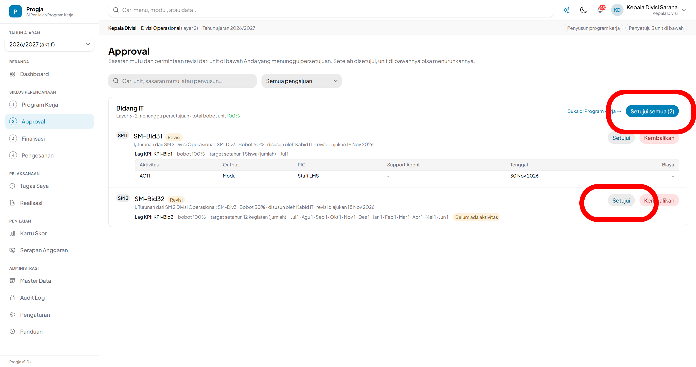
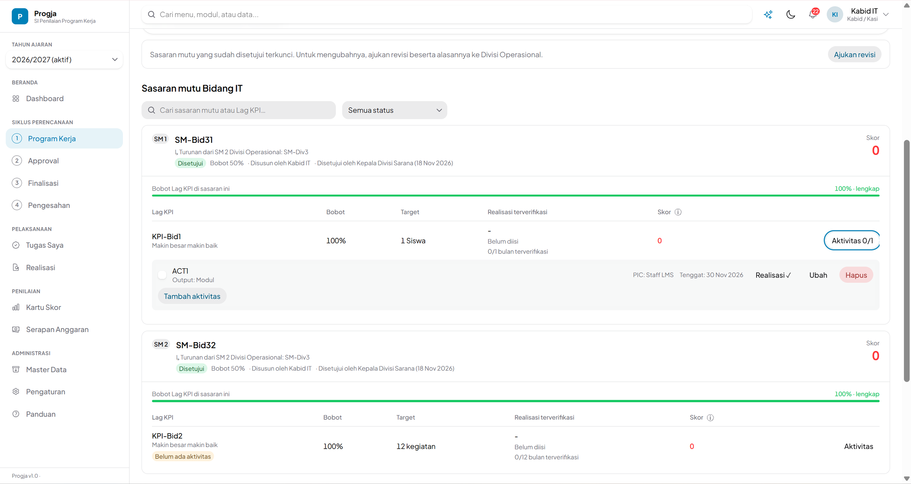

# Approval

Divisi atau Yayasan bisa melakukan persetujuan dari sasaran mutu yang diturunkannya ke bidang. Kemudian, dari bidang di tambahkan lagi sasaran mutu untuk diturunkan lagi ke staff, namun harus melalui persetujuan divisi atau yayasan.

## Langkah Untuk menyetujui di Divisi

1. Buka menu **Approval**.
2. Baca terlebih dahulu informasi di sasaran mutu yang diajukan oleh bidang.
3. Apabila sudah sesuai dan benar, klik **Setujui** bisa satu satu atau langsung semua dengan klik **Setujui semua**.
4. Notifikasi berhasil akan muncul. Dan status sasaran mutu yang diajukan di bidang tadi, akan berubah menjadi **Disetujui**.

# Informasi 

Membuat aktivitas ini tidak hanya dilakukan di bidang, tapi bisa di unit lain