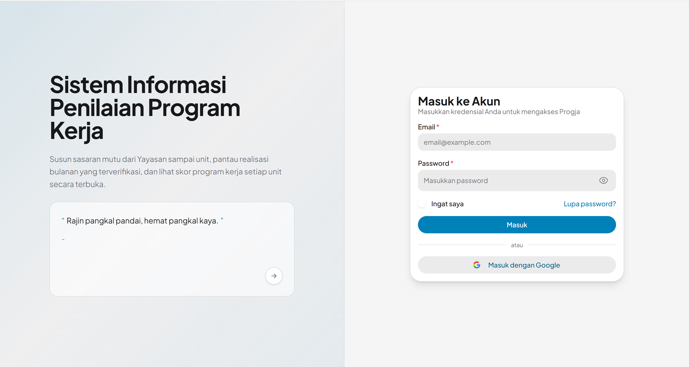
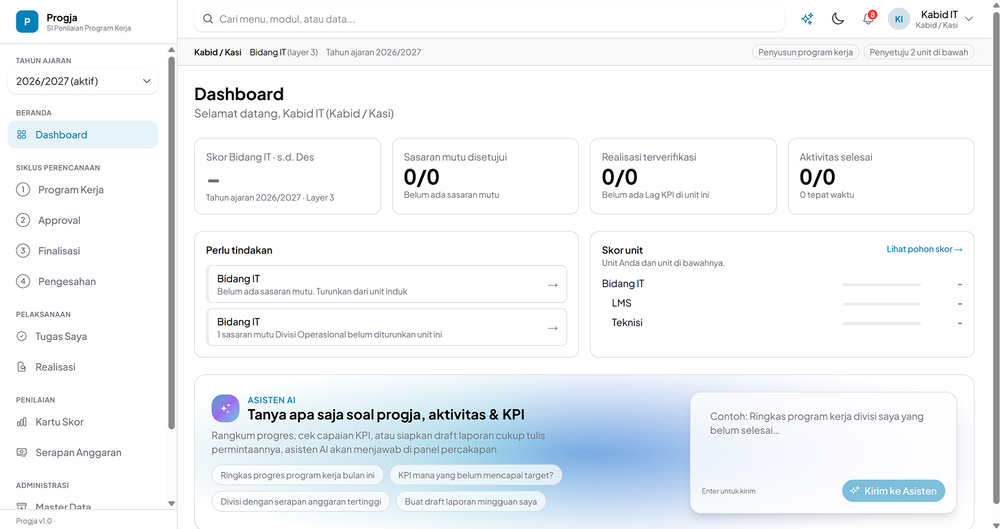
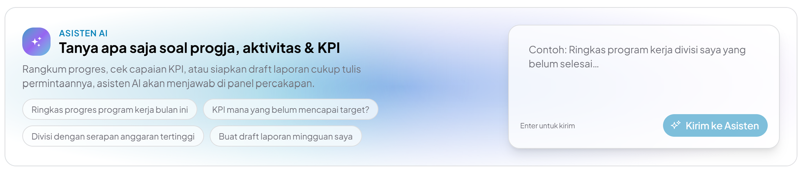

# Login

Cara login ke Progja dan memahami dashboard dasar.

**Informasi**

Pastikan Anda login dengan akun Bidang. Menu yang tampil mengikuti peran akun Anda.

## Langkah Login

1. Buka alamat sistem Progja di browser.
2. Masukkan **email** dan **password**, lalu klik **Masuk**.
3. Jika **password** lupa, gunakan tautan **Lupa password** pada halaman login.

Login juga bisa dilakukan melalui akun google dengan mengklik button **Masuk dengan Google** dan pilih akun google yang akan digunakan untuk login sistem ini.

## Mengenal Dashboard

Setelah berhasil login, dashboard Bidang menampilkan: Skor bidang IT, Sasaran mutu disetujui, Realisasi terverifikasi, dan Aktivitas selesai. Kemudian di dashboard juga ditampilkan sasaran mutu yang perlu tindakan. Kemudian ada papan Skor unit yang berisi turunannya Bidang.

## Asisten AI

Di dashboard juga terdapat layanan Asisten AI yang mampu membantu merangkum progres, mengecek capaian KPI, dan aktivitas.

