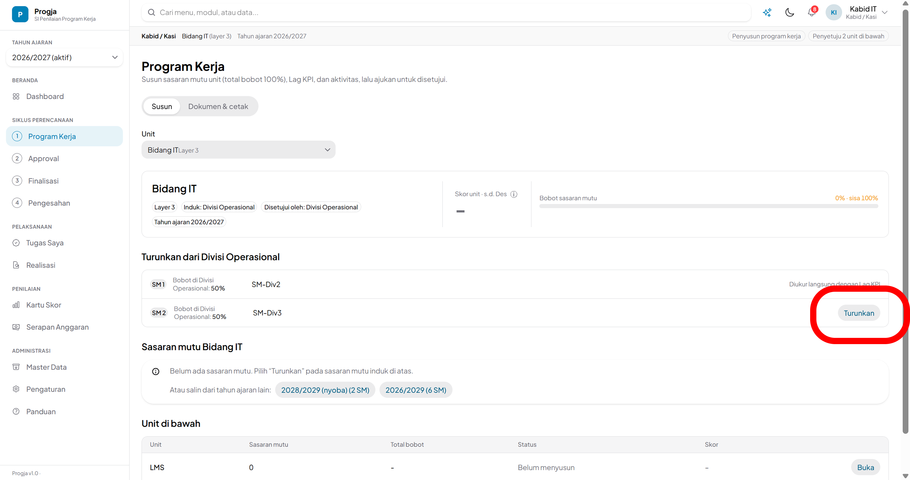
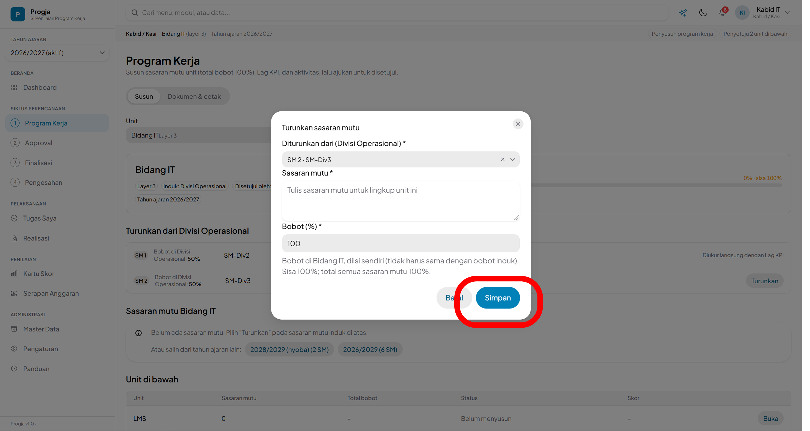
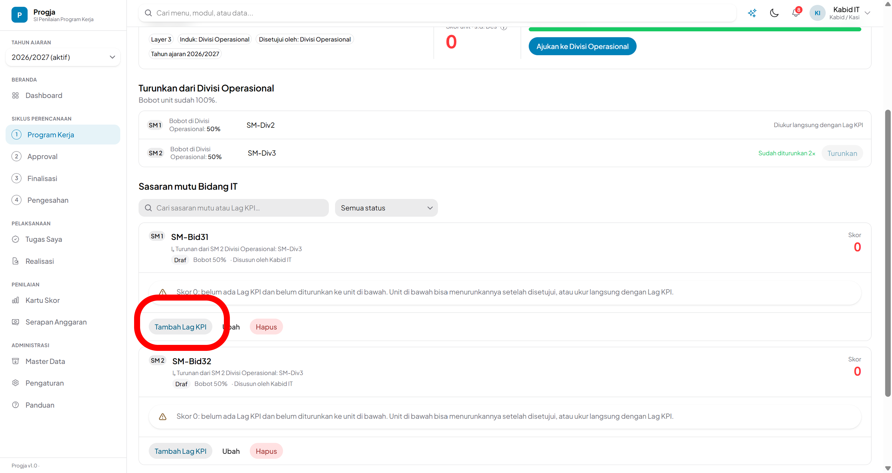
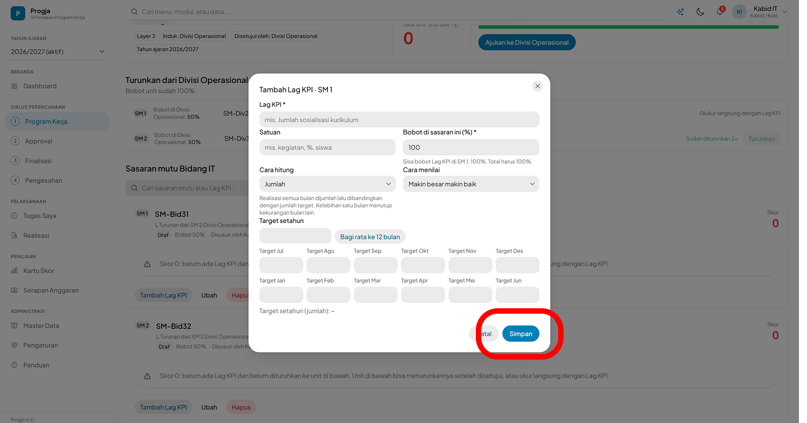
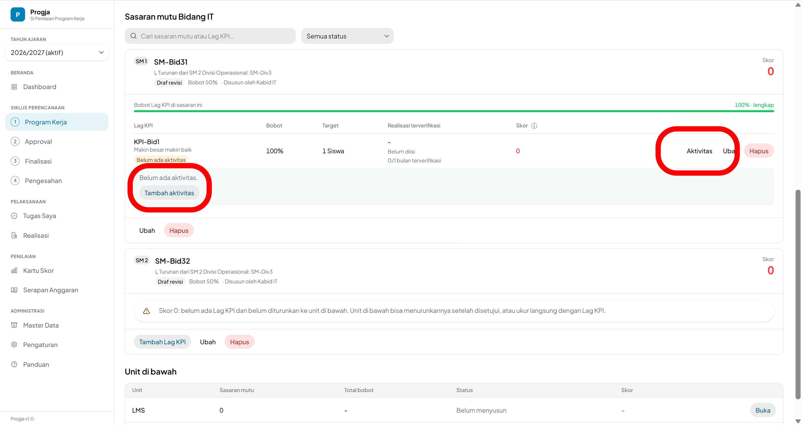
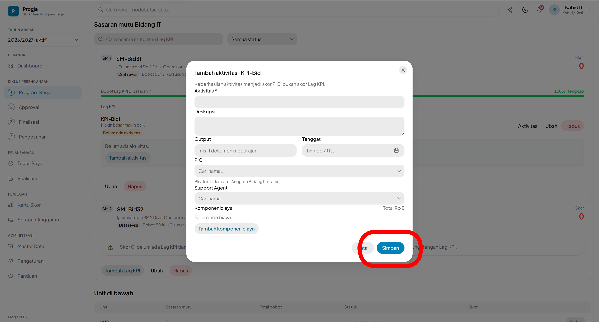
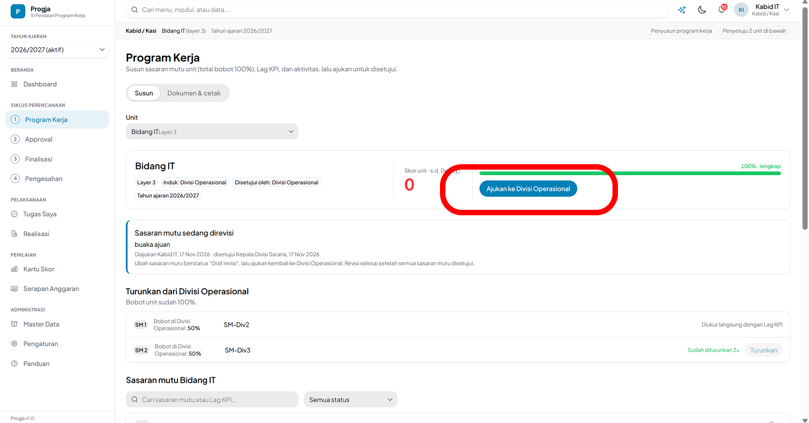
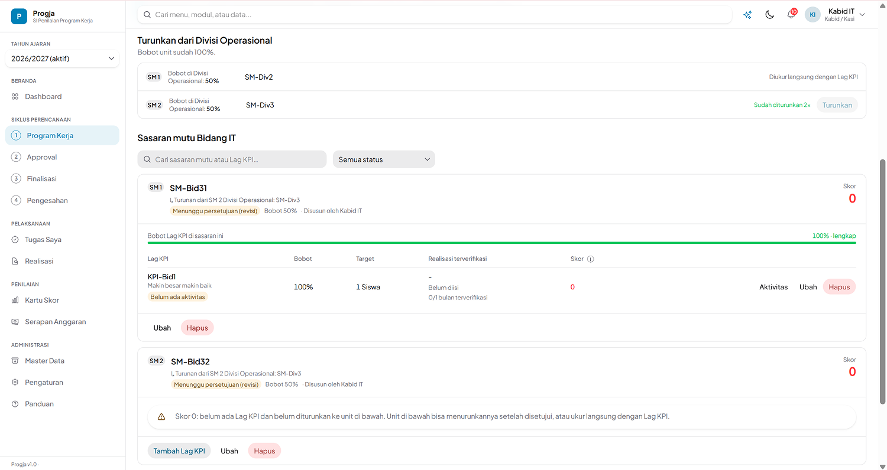

# Membuat Sasaran Mutu 

Bidang membuat sasaran mutu dari sasaran mutu yang sudah diturunkan oleh divisi dan sudah disetujui divisi atau yayasan.

## Langkah Membuat Sasaran Mutu

1. Buka menu **Program Kerja**.
2. Klik **Turunkan**.
3. Masukkan nama sasaran mutu dan bobotnya di form **Turunkan sasaran mutu**.
4. Kemudian klik **Simpan**. Akan ditampilkan berapa kali satu sasaran mutu divisi diturunkan di bidang.
5. Sasaran mutu yang sudah dibuat akan tersimpan di area tampilan **Sasaran mutu bidang**.

Sasaran mutu yang sudah diisi sendiri oleh bidang, tidak dapat diturunkan di bidang, sehingga keterangannya Diukur langsung dengan Lag KPI.

Perhatikan penjumlahan persentase bobot sasaran mutunya. Sasaran mutu bidang hanya bisa disahkan setelah jumlah persentase dari sasaran mutu - sasaran mutu mencapai 100%.

## Menambah Lag KPI
1. Buka menu **Program Kerja**.
2. Pastikan sudah ada sasaran mutu yang diturunkan oleh divisi dan sudah disetujui oleh yayasan. 
3. Klik **Tambah Lag KPI**.
4. Isi semua form **Tambah Lag KPI** dengan sesuai dan benar.
5. Klik **Simpan**.

Selama bobot Lag KPI di dalam satu sasaran mutu belum mencapai 100%, maka Lag KPI masih bisa ditambahkan.

Catatan: Form Target setahun bisa diisi manual satu-satu, dan bisa juga langsung membaginya ke 12 bulan dengan klik "Bagi rata ke 12 bulan".

**Informasi**

Lag KPI ini bisa ditambahkan langsung oleh bidang (kasusnya seperti di yayasan) dengan mengikuti cara di atas, atau menurunkannya ke staff. Jika ingin menurunkannya ke staff kosongkan Lag KPI di bidang.

## Menambah Aktivitas di Lag KPI

1. Buka menu **Program Kerja**.
2. Klik **Aktivitas** di baris Lag KPI yang akan di tambahkan aktivitas.
3. Isi form **Tambah Aktivitas** dengan sesuai dan benar. Isi PIC untuk menentukan Lag KPI aktivitas ini akan diturunkan ke mana.
4. Kemudian klik **Simpan**. 

## Sahkan Sasaran Mutu
1. Pastikan bobot persentase sasaran mutunya sudah 100%.
2. Klik **Ajukan ke Divisi**.
3. Notifikasi berhasil akan muncul. Dan akan masuk ke menu approval di yayasan dan divisi.

Karena ini di bidang, maka pengajuan akan melalui yayasan dan divisi. Namun, apabila di divisi sudah disetujui, maka approval di yayasan akan mengikuti di divisi. Sehingga status di sasaran mutu bidang akan terlihat seperti tampilan di bawah, Menunggu persetujuan.

