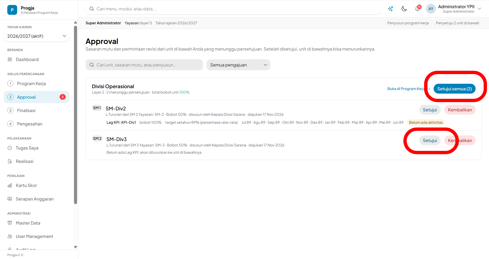
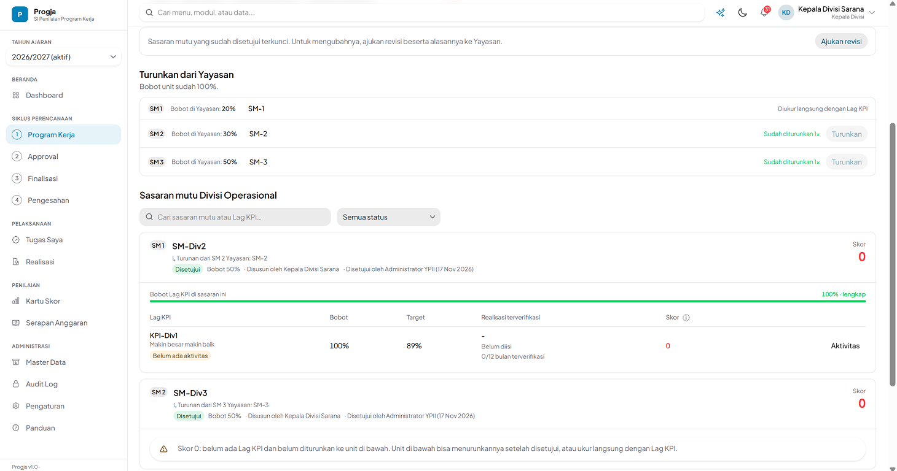

# Approval

Yayasan melakukan persetujuan dari sasaran mutu yang diturunkannya ke divisi. Kemudian, dari divisi di tambahkan lagi sasaran mutu untuk diturunkan lagi ke bidang, namun harus melalui persetujuan yayasan.

## Langkah Untuk menyetujui di Yayasan

1. Buka menu **Approval**.
2. Baca terlebih dahulu informasi di sasaran mutu yang diajukan oleh divisi.
3. Apabila sudah sesuai dan benar, klik **Setujui** bisa satu satu atau langsung semua dengan klik **Setujui semua**.
4. Notifikasi berhasil akan muncul. Dan status sasaran mutu yang diajukan di divisi tadi, akan berubah menjadi **Disetujui**.

# Informasi 

Membuat aktivitas ini tidak hanya dilakukan di divisi, tapi bisa di unit lain