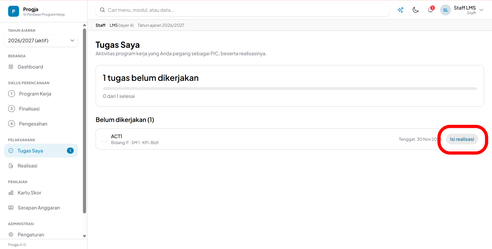
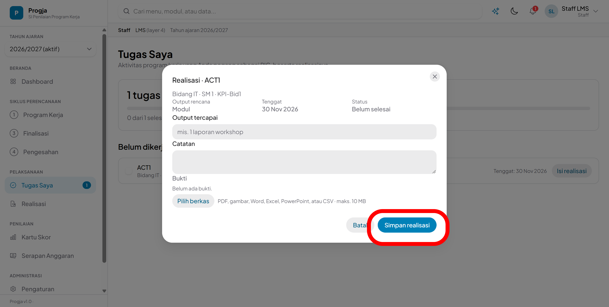
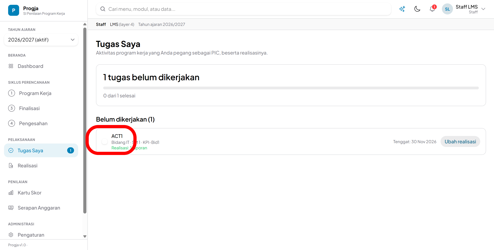
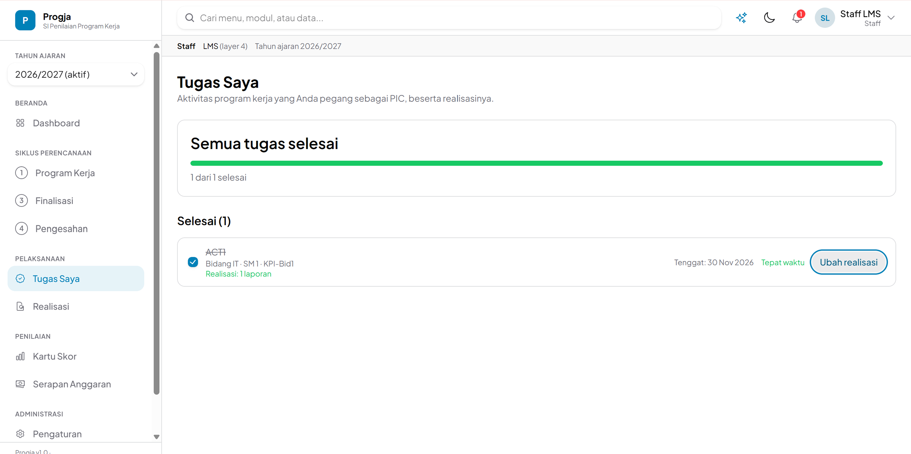

# Menerima Tugas 

Staff menerima tugas dari sasaran mutu, Lag KPI, dan aktivitas yang sudah diturunkan dan ditambahkan oleh divisi, bidang, dan sudah difinalisasi oleh yayasan.

## Langkah Mengisi Realisasi

1. Buka menu **Tugas Saya**.
2. Klik **Isi realisasi**.
3. Masukkan Output yang tercapai dan Catatan (opsional) di form Realisasi.
4. Kemudian klik **Simpan reaslitasi**. 

## Tugas Selesai

Tandai tugas yang sudah selesai dengan mengklik checkboxnya.

