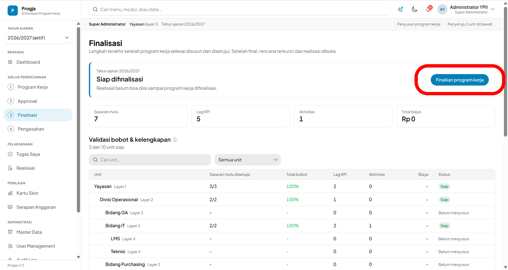
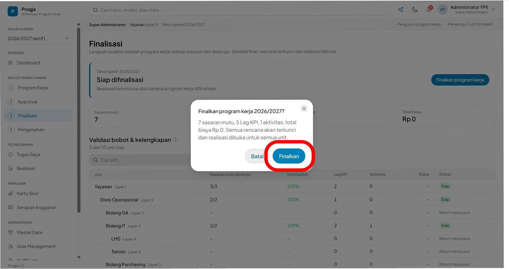

# Finalisasi

Setelah sasaran mutu dan KPI selesai dibuat oleh Divisi/Bidang, Yayasan melakukan finalisasi.

## Langkah Finalisasi

1. Buka menu **Finalisasi**.
2. Klik **Finalkan program kerja**.
3. Cek validasi bobot & kelengkapannya.
4. Kemudian klik **Finalkan**.
5. Setelah selesai, sasaran mutu, Lag KPI, dan aktivitas statusnya menjadi siap.

