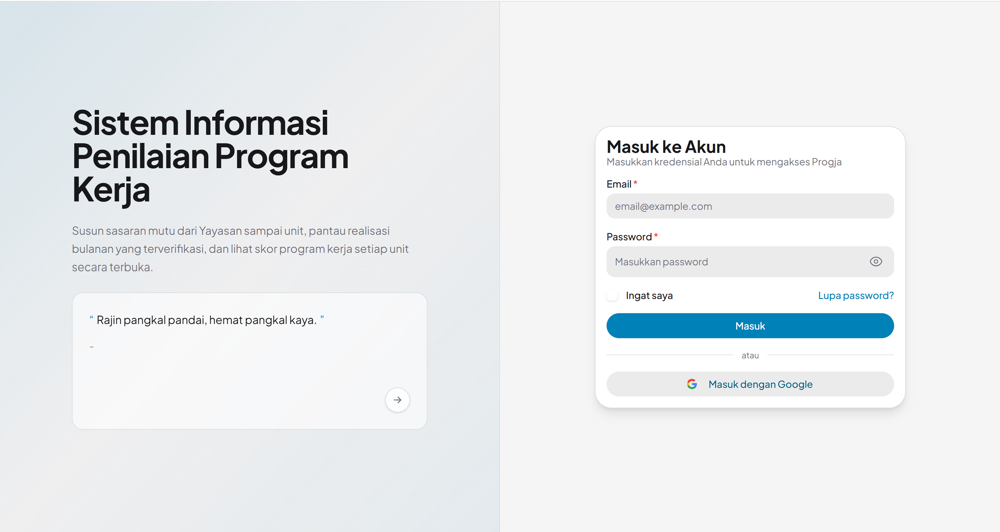
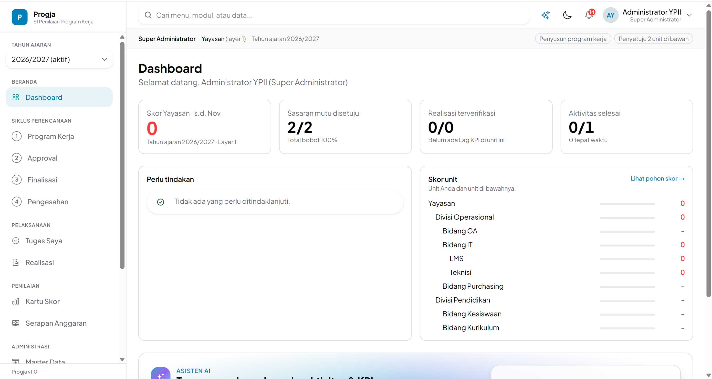
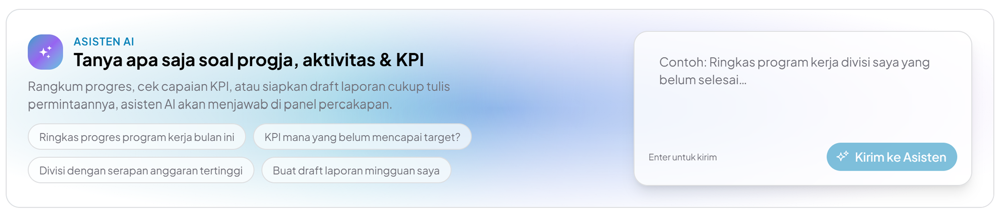

# Login

Cara login ke Progja dan memahami dashboard dasar.

**Informasi**

Pastikan Anda login dengan akun Yayasan. Menu yang tampil mengikuti peran akun Anda.

## Langkah Login

1. Buka alamat sistem Progja di browser.
2. Masukkan **email** dan **password**, lalu klik **Masuk**.
3. Jika **password** lupa, gunakan tautan **Lupa password** pada halaman login.

Login juga bisa dilakukan melalui akun Google dengan mengklik tombol **Masuk dengan Google** dan pilih akun Google yang akan digunakan untuk login sistem ini.

## Mengenal Dashboard

Setelah berhasil login, dashboard Yayasan menampilkan: Skor Yayasan, Sasaran mutu yang dietujui, Realisasi terverifikasi, dan Aktivitas selesai. Kemudian, di tampilan dashboard juga ditampilkan sasaran mutu yang perlu ditindaklanjuti. Kemudian ada papan Skor unit yang berisi, turunannya Yayasan Divisi, Bidang.

## Asisten AI

Di dashboard juga terdapat layanan Asisten AI yang mampu membantu merangkum progres, mengecek capaian KPI, dan aktivitas.

