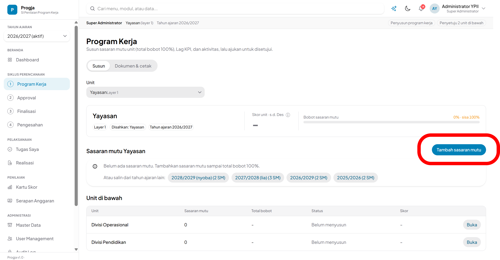
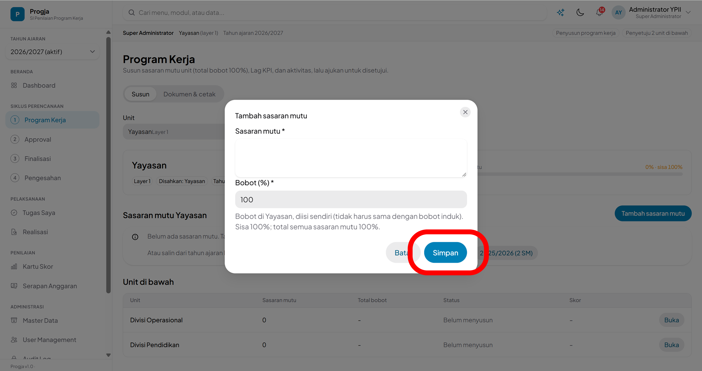
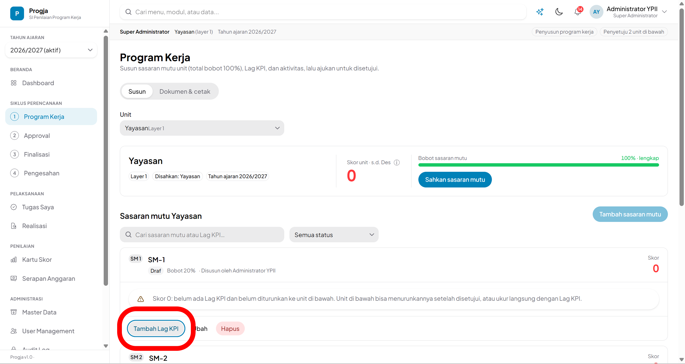
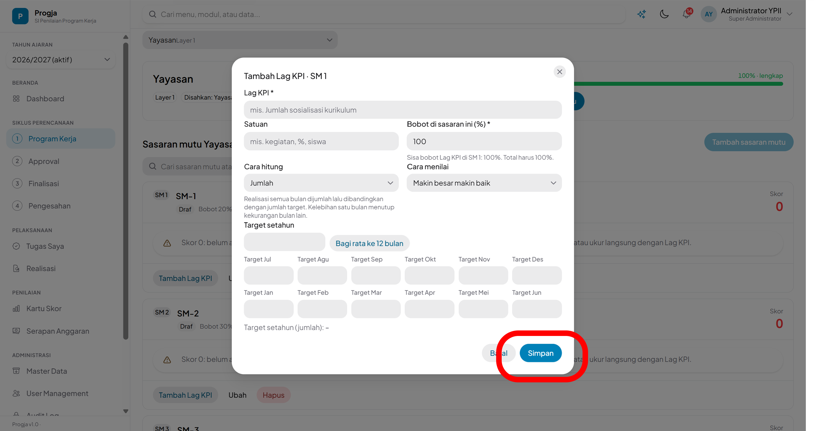
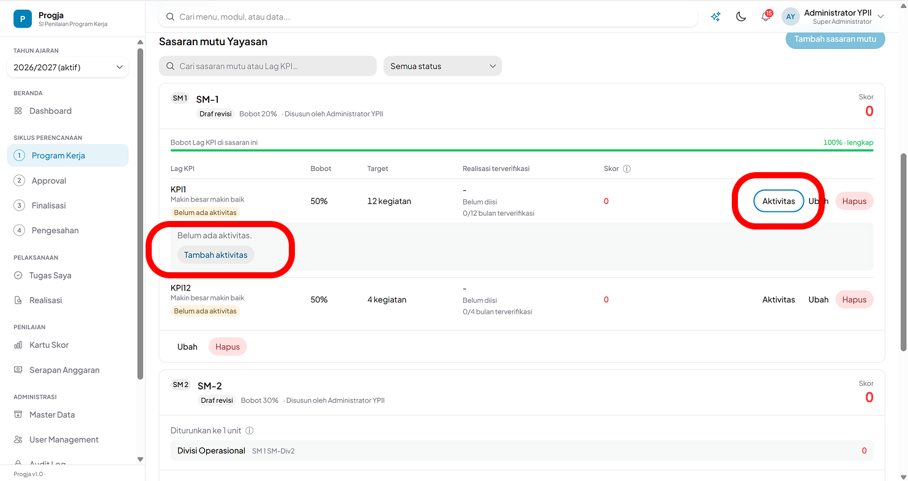
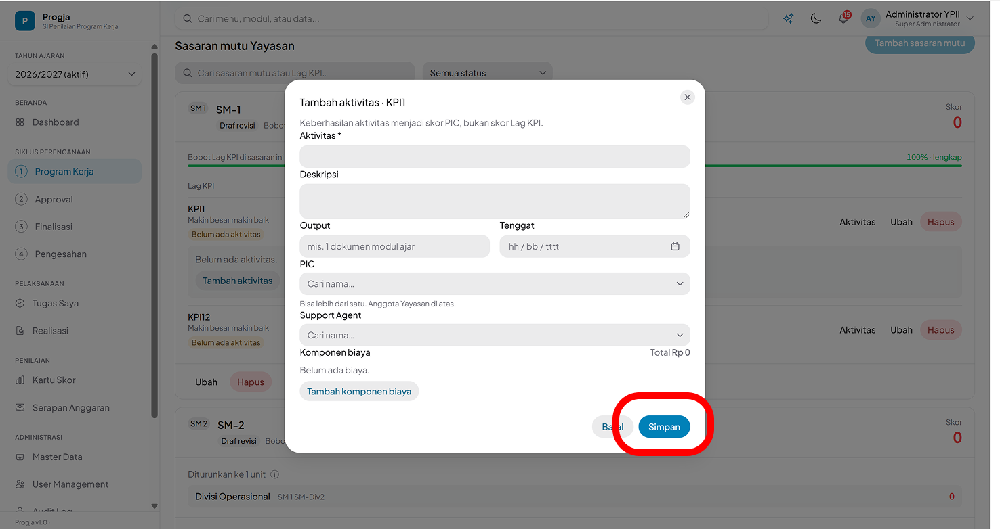
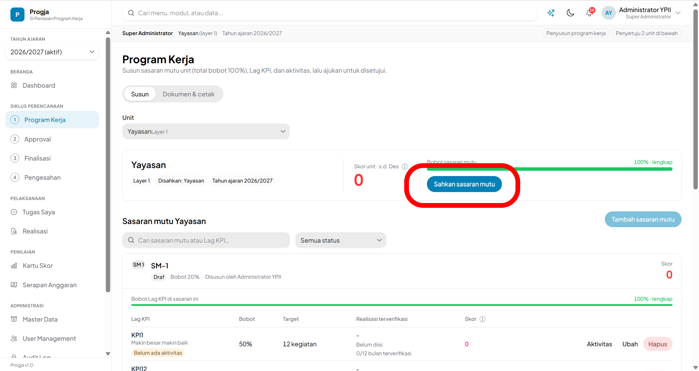
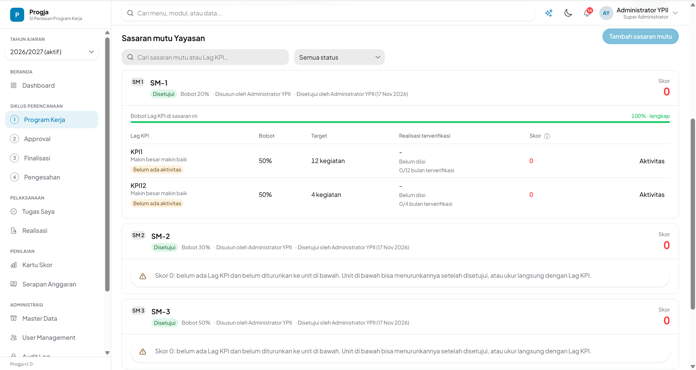

# Membuat Sasaran Mutu 

Yayasan dapat membuat dan mengajukan sasaran mutu (program kerja) sendiri.

## Langkah Membuat Sasaran Mutu

1. Buka menu **Program Kerja**.
2. Klik **Tambah sasaran mutu**.
3. Masukkan nama sasaran mutu dan bobotnya di form **Tambah sasaran mutu**.
4. Kemudian klik **Simpan**.
5. Sasaran mutu yang sudah dibuat akan tersimpan di area tampilan **Sasaran mutu yayasan**.

Perhatikan penjumlahan persentase bobot sasaran mutunya. Sasaran mutu yayasan hanya bisa disahkan setelah jumlah persentase dari sasaran mutu - sasaran mutu mencapai 100%.

## Menambah Lag KPI
1. Buka menu **Program Kerja**.
2. Pastikan sudah ada sasaran mutu yang ditambahkan.
3. Klik **Tambah Lag KPI**.
4. Isi semua form **Tambah Lag KPI** dengan sesuai dan benar.
5. Klik **Simpan**.

Selama bobot Lag KPI di dalam satu sasaran mutu belum mencapai 100%, maka Lag KPI masih bisa ditambahkan.

Catatan: Form Target setahun bisa diisi manual satu-satu, dan bisa juga langsung membaginya ke 12 bulan dengan klik “Bagi rata ke 12 bulan”.

**Informasi**

Lag KPI ini bisa ditambahkan langsung oleh yayasan mengikuti cara di atas, atau menurunkannya ke divisi. Jika ingin menurunkannya ke Divisi, kosongkan Lag KPI di yayasan.

## Menambah Aktivitas di Lag KPI

1. Buka menu **Program Kerja**.
2. Klik **Aktivitas** di baris Lag KPI yang akan di tambahkan aktivitas.
3. Isi form **Tambah Aktivitas** dengan sesuai dan benar. Isi PIC untuk menentukan Lag KPI aktivitas ini akan diturunkan ke mana.
4. Kemudian klik **Simpan**. 

## Sahkan Sasaran Mutu
1. Pastikan bobot persentase sasaran mutunya sudah 100%.
2. Klik **Sahkan sasaran mutu**.
3. Notifikasi berhasil akan muncul.

Karena ini di yayasan, maka setelah pengajuan akan langsung  seperti terlihat ditampilan bawah, terdapat status per sasaran mutu. Status sasaran mutu disetujui.

